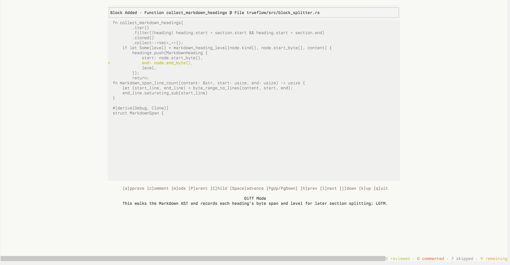

# trueflow




Trueflow is a semantic local code review tool.

Website: <https://trueflow.dev>

It lets you review existing repository content and diffs as semantic **blocks**
instead of raw diff hunks. It is built for local CLI/TUI/Emacs workflows and
stores review state in an append-only flat file database, e.g.
`.trueflow/reviews.jsonl`.

## What it does

- reviews existing code and whole repositories, not just diffs
- scans a working tree or revision range into semantic review `blocks` (a
  `block` is some semantic unit of content, e.g. `Method`, `Struct`,
  `CodeParagraph`)
- presents review targets in a stable priority order so higher-priority
  material appears first
- lets you approve, reject, or comment on `blocks`
- stores review records in `.trueflow/reviews.jsonl`
- exports review feedback for agents and other automation

## Current model and status

- The canonical review unit is a **block**, not a textual diff hunk.
- Canonical review order is deterministic: tests before library code before main
  entrypoints, with higher-priority block kinds first within a file.
- An optional session-local AI review plan can add a priority prefix. It never
  removes or duplicates targets; every omitted block remains in canonical
  relative order.
- Pressing Esc on the AI briefing preserves canonical order.
- Runtime config lives in `trueflow.toml`.
- Current website-distributed binary support is Apple Silicon macOS and Linux x86_64.


Still some rough edges.

- The current public CLI field name is still `fingerprint`.
- Diff fingerprints and content-addressed block identities both exist today and
  are not fully unified yet.

## Install

For current install instructions and release downloads, see:

- <https://trueflow.dev/install/>

Current website-distributed binary support: Apple Silicon macOS and Linux x86_64.

### Alternative install paths

With Nix:

```sh
nix profile install github:trueflow-dev/trueflow
```

With Cargo:

```sh
# Install Rust and Cargo first: https://rustup.rs
git clone git@github.com:trueflow-dev/trueflow.git
cd trueflow
cargo install --path trueflow --locked
```

`cargo install` usually puts the `trueflow` binary in `~/.cargo/bin`, so make
sure that directory is on your `PATH`.

## Official language support

Trueflow always falls back to semi-smart text processing when official
semantic/AST blocking is not available yet. That fallback still gives you
usable review units via paragraphs, sentences, code chunks, comments, and the
usual review-priority heuristics.

In the matrix below:

- `✅` = official semantic/structured blocking today
- `🚧` = detection/fallback works today, but official semantic/AST blocking is
  still coming soon
- `Subblock split` means language-specific `inspect --split` behavior, not only
  generic code fallback

Review priority heuristics apply across all review targets, including fallback
modes.

### Official semantic / structured blocking today

| Language | Semantic / AST blocks | Subblock split | Complexity scoring | TUI highlight |
| --- | --- | --- | --- | --- |
| Rust | ✅ | ✅ | ✅ | ✅ |
| Swift | ✅ | ✅ | ✅ | ✅ |
| Emacs Lisp | ✅ | ✅ | ✅ | ✅ |
| JavaScript | ✅ | ✅ | ✅ | ✅ |
| TypeScript | ✅ | ✅ | ✅ | ✅ |
| Java | ✅ | ✅ | ✅ | ✅ |
| Kotlin | ✅ | ✅ | ✅ | ✅ |
| C# | ✅ | ✅ | ✅ | ✅ |
| Python | ✅ | ✅ | ✅ | ✅ |
| Ruby | ✅ | ✅ | ✅ | ✅ |
| PHP | ✅ | ✅ | ✅ | ✅ |
| Shell | ✅ | — | ✅ | ✅ |
| C | ✅ | ✅ | ✅ | ✅ |
| Go | ✅ | ✅ | ✅ | ✅ |
| C++ | ✅ | ✅ | ✅ | ✅ |
| Zig | ✅ | ✅ | — | — |
| Lua | ✅ | ✅ | — | — |
| Dart | ✅ | ✅ | — | — |
| Scala | ✅ | ✅ | — | — |
| Haskell | ✅ | ✅ | — | — |
| OCaml | ✅ | ✅ | — | — |
| Elixir | ✅ | ✅ | — | — |
| Clojure | ✅ | ✅ | — | — |
| SQL | ✅ | — | — | — |
| YAML | ✅ | ✅ | — | — |
| JSON | ✅ | ✅ | — | — |
| HTML | ✅ | ✅ | — | — |
| CSS | ✅ | ✅ | — | — |
| Markdown | ✅ | ✅ | — | — |
| TOML | ✅ | ✅ | — | — |
| Nix | ✅ | ✅ | — | ✅ |

### Fallback / heuristic support today, official semantic / AST blocking coming soon

| Language | Semantic / AST blocks | Subblock split | Complexity scoring | TUI highlight |
| --- | --- | --- | --- | --- |
| Just | 🚧 | — | — | ✅ |
| Text / Org | 🚧 | ✅ | — | — |

Notes:

- Most `✅` code languages use tree-sitter-backed structural blocking.
- Markdown, TOML, and some config/data formats use custom structured splitting
  instead of a full AST.
- `🚧` languages still work today through heuristic or text-oriented fallback,
  but they are not yet at the same official semantic/AST support level.

Worktree files and Git revision blobs share byte-based language detection,
semantic splitting, hashing, and parser diagnostics. Extensionless shell scripts
are recognized by their shebang in either source.

## Operator docs

Website/deployment/infrastructure docs live in `infra/README.md`.

## Quick start

```sh
# Launch the TUI. The main way to use trueflow.
trueflow tui

# Start a short, LLM-generated first-pass review of this repository
trueflow onboard

# Review a GitHub pull request in the TUI
trueflow tui --target pr:11

# Review only documentation, signatures, and data-structure shapes.
trueflow tui --mode declarations

# Explicitly trust the workspace before requesting callers, callees, or type uses.
trueflow tui --mode declarations --trust-lsp-workspace

# Review current changes as JSON. Machine-readable, suitable for integrations.
trueflow review --json


# Inspect and split a block
trueflow inspect --fingerprint <fp> --split

# Export review feedback
trueflow feedback --format xml

# Stage review feedback on a GitHub pull request without submitting it
trueflow feedback --pr pr:11 --dry-run

# Export recent feedback for one subtree
trueflow feedback --format json --since 1h --target dir:trueflow/src
```

### Onboard a repository

`trueflow onboard` asks an LLM CLI to identify foundational abstractions,
functions, types, and core flows among the repository's unreviewed blocks, then
opens the first selected card directly in the TUI. Each card includes an opening
description explaining its importance and review focus. There is no setup wizard
or second AI briefing.

The default is **Codex CLI, `gpt-6`, high reasoning**. Install and authenticate
`codex` first (`codex login`). Explicit `[ai].provider` and `[ai].model` settings
still apply; onboarding requires a CLI provider (`codex_cli` or `claude_cli`).
Invoking onboarding requests generation even when ordinary TUI AI is off.
Generation sends selected repository context to the configured provider and
allows its CLI to inspect the repository; Codex runs in its read-only sandbox.
Because the agent explores the repository, generation has a 600-second deadline
by default (`--timeout 1..3600` seconds); a provider that exceeds it is stopped
and no plan is generated.

The model is asked to aim for 8–24 cards, with a hard maximum of 64. Trueflow
also enforces a 14-minute **reading estimate**: two seconds per source line plus
ten seconds per card. Actual review time depends on complexity and reading pace.
This is a focused first pass, not an exhaustive review or a security assessment.
Scan diagnostics remain visible; unsupported or omitted content is not certified.

Use `a` to approve, `c` to comment, `l` or Space to skip/advance, `h` for a
previous pending card, and `q` to quit (configured action keys still apply).
Cards stay in the generated order and source mode. Parent, child, and root
navigation are disabled so a batch action cannot approve unrelated code.
Approvals and comments use the ordinary review store. Skipping does not approve.
The final recap ends this pass rather than opening the repository scope picker.

#### Portable review specifications

The same versioned JSON format can be generated, shared, edited, or authored by
another tool. It does not depend on a particular LLM:

```sh
# Generate without launching the TUI; save stdout wherever you keep review plans.
trueflow onboard --json

# Open an existing plan without invoking an LLM.
trueflow onboard --plan /path/to/review.json

# Resolve and check a plan without opening the TUI or writing review records.
trueflow onboard --plan /path/to/review.json --json

# Query the same unreviewed candidates available to the LLM; no LLM required.
trueflow onboard --candidates --path src --offset 0 --limit 64
```

A specification is an object with these required fields; unknown fields are
rejected:

- `version`: `1`.
- `title`: nonblank text, at most 120 characters.
- `description`: nonblank opening text, at most 1,000 characters.
- `steps`: an ordered array of 1–64 objects, each containing:
  - `description`: nonblank card introduction, at most 600 characters.
  - `target`: copy a candidate's complete `target` object:
    - `path`: repository-relative file path.
    - `start_line`, `end_line`: one-based, inclusive line range.
    - `start_byte`, `end_byte`: zero-based, half-open UTF-8 byte range.
    - `content_hash`: lowercase SHA-256 of the exact block bytes, without
      whitespace normalization. This differs from the review `fingerprint`.

Targets name complete, distinct, non-overlapping leaf review blocks. The byte
range disambiguates multiple blocks on the same line. Source locations and hashes
are checked before execution; stale or invented targets fail rather than being
silently substituted. Previously approved or currently filtered-out targets are
not queued. Selected source files are captured before the TUI opens, so later
worktree edits do not replace the code under an existing card's identity.

Candidate queries return `total_candidates`, `offset`, `next_offset` (null at
the end), `diagnostics`, and `candidates`. Each candidate includes its `target`,
review `fingerprint`, `kind`, `estimated_seconds`, and a bounded source `excerpt`.
Pages use stable path/source order, not importance order; the LLM can query
different paths and read full source before selecting. Queries always cover the
repository root, even when invoked from a subdirectory, and honor scan/review
filters and existing approval coverage. Pagination reflects current worktree and
review state; final target resolution is authoritative.

### Focus a short review on consequential code

```sh
trueflow focus --duration 5m
trueflow focus --duration 10m --path src
trueflow focus                         # asks for a duration before generation
trueflow focus --duration 5m --json    # generate a portable specification
trueflow focus --plan review.json     # reopen without invoking an LLM
trueflow focus --plan review.json --json
trueflow focus --candidates --path src --offset 0 --limit 64
```

Unlike `onboard` (an architectural first pass), `focus` asks the LLM to select
code worth human attention for its expected review value per minute. It considers
all unreviewed leaf candidates in the selected scope, including commented or
rejected code; valid approvals remain excluded. Scan/review filters still apply.
Durations accept explicit `m` or `s` units, from one second through 60 minutes.
Non-interactive generation requires `--duration`. A `--path` that matches no
scanned source file is an error, and a scope without unreviewed blocks is
reported as such rather than as a reading-budget problem.

Trueflow supplies source-pinned evidence: existing complexity metadata, lexical
entry-point/trust-boundary/write/error/concurrency signals, effective review
records and notes, heuristic related-test links, and recent immutable Git patch
excerpts. These are observations, **not findings**. Related tests are not measured
test coverage; review records are not independently verified reviewer identities.
History inspects up to eight first-parent commits and is file-local, not precise
historical-to-current block attribution. Missing/truncated evidence is explicit.
Generated/vendor/test-heavy content and mechanical whitespace churn are labeled
for discounting. There is no whole-program call graph or executed test analysis.

Every model-selected card must cite evidence IDs for its exact target and include
a reason, uncertainty, and concrete inspection questions. Bounded multi-pass
selection visits every in-budget candidate before reducing model-selected
shortlists; it does not silently take the first files. Each pass selects at most
eight cards. Generation has a shared 120-second deadline (`--timeout 1..600`) and
at most 32 calls with 64 KiB prompts. Excessive scope fails explicitly; narrow
`--path`. No partial or heuristic fallback queue is substituted on failure.

The application enforces a **reading estimate**, not a timer: two seconds per
source line plus ten seconds per complete card. Oversized blocks are reported,
not truncated. There are no elapsed-time, pause, or extend controls. Actual
review can take longer. Source, review state, and evidence are rechecked after
generation; stale/invented references fail. Saved plans revalidate their remaining
cards and omit already-approved cards. Reopening a plan gathers evidence only for
the files it targets, so `--plan` takes no `--path` and still opens in repositories
whose whole inventory exceeds the candidate limits.

In the TUI, `F1` opens full reasons, uncertainty, questions, and cited evidence.
Use arrows, `j`/`k`, or PageUp/PageDown to scroll; Escape/F1 closes the panel.
Approve/comment/skip and persistence work as in onboarding. The queue cannot
widen to unrelated blocks, and its recap does not claim repository completion.

Focus specifications have `version: 1`, `duration_seconds`, `title`, `description`,
and `steps`. Each step has an exact onboarding-style `target`, `reason`,
`evidence` (1–6 candidate evidence IDs), `uncertainty`, and `checks` (1–4 questions).
Targets must be distinct, non-overlapping complete blocks. Saved specifications
allow at most 64 cards within the declared estimate. Inspect `--candidates` for
the current evidence catalogue and estimates; its pages use stable source order,
not a risk ranking.

Focus uses the configured CLI provider even when ordinary TUI AI is off.
**Codex uses a read-only sandbox with supported tool features disabled**, ignores
user configuration/rules, and disables web search. This is weaker than tool-free
generation and is not a confidentiality boundary. Claude disables tools, MCP,
and customizations; `model = "auto"` uses Claude CLI's own default model.
Both send evidence to the configured service; neither automatically records a verdict.

An opt-in synthetic live-model comparison is available:

```sh
cargo build --manifest-path trueflow/Cargo.toml --bin trueflow --example evaluate_focus
cargo run --manifest-path trueflow/Cargo.toml --example evaluate_focus -- --provider claude_cli
```

It compares real 5m/10m focus selections against ordinary `ReviewOrder`, including
planted consequential paths and noisy controls. The JSON report measures concern
spans *selected*, not bugs discovered or demonstrated human productivity. It
requires provider authentication and may incur charges; CI uses isolated fake
providers and actual PTY/persistence regressions instead.

## Filter and scope review

```sh
# Review only functions
trueflow review --all --only function --json

# Exclude comments from feedback output (gaps are skipped by default)
trueflow feedback --exclude comment

# Launch the TUI scoped to one file
trueflow tui --target file:src/lib.rs

# Scope the review to an entire directory subtree
trueflow review --target dir:website --json
trueflow tui --target dir:trueflow/src

# Scope the TUI to a revision range with additional filtering
trueflow tui --target rev:abc1234..def5678 --only function --exclude comment

# Scope the TUI to a GitHub pull request by number or URL
trueflow tui --target pr:11
trueflow tui --target https://github.com/owner/repo/pull/11
```

Block kinds are case-insensitive and match the semantic kinds shown in JSON
output.

`main` reviews committed changes from the mainline merge base to the HEAD
captured when the review starts. Uncommitted edits are excluded; use `dirty`
to review the working tree. Historical comparisons cannot be mixed with `dirty`
in one target list. Source views, diffs, and comment anchors retain the captured
revision even if branches move during the session.

## Runtime config

Trueflow first loads `~/.trueflow.toml` as global defaults, if present. It then
loads every `trueflow.toml` from the filesystem root down to the current
directory, with closer files overriding earlier defaults key-by-key. CLI flags
still take precedence over config values.

```toml
[ai]
# AI mode: off|review_plan|block_hints|review_plan_and_block_hints.
mode = "off"
# Provider: auto|anthropic|open_ai|claude_cli|codex_cli|none.
provider = "codex_cli"
model = "auto"
# Codex's "auto" model resolves to gpt-6; Codex reasoning effort is high.
max_context_lines = 80
# In-session cache for block-hint responses.
cache = true

[review]
only = ["function", "struct"]
exclude = ["comment"]

[feedback]
exclude = ["comment"]

[tui]
# Review modality: blocks|declarations. CLI --mode takes precedence.
mode = "blocks"

# disabled|old_new
# default: disabled
# diff_line_numbers = "old_new"

[tui.keybinds]
scroll_up = "k"
scroll_down = "j"
prev = "h"
next = "l"
parent = "P"
child = "C"
approve = "a"
note = "c"
toggle_view = "m"
speed_read = "r"
root = "g"
recap_done = "d"
quit = "q"

[tui.speed_read]
enabled = true
default_wpm = 320
default_chunk_words = 2
```

See `trueflow.example.toml` for the default settings.

Ordinary AI review plans distribute their bounded manifest across files and
source/test groups, share excerpt space, and retain changed-head context.
Clipped source is labeled partial; priorities only reorder the ordinary queue.
CLI provider execution has a 120-second default timeout and bounded output.
Leaving the AI-plan loading screen cancels its provider process group.

## Interfaces

### TUI

Without `--target`, the TUI opens a review scope selector listing all files,
the diff against main, and HEAD's first-parent commits. Older commits load in
pages of 50 as the selection nears the end of the list, so `j`/Down reaches any
commit back to the root. When launched from a subdirectory, only commits that
touch it are listed. Each commit's remaining-review status is computed in the
background only while its row is on screen.

Main review actions:

- In the root view, `j`/`k` and Up/Down move the selection through the visible file/dir list
- In the root view, `l`, Right, Enter, and `C` open the selected item; `h`, Left, and `P` are back/leftward actions and are a no-op at the repository root
- Outside the root view, `j`/`k` and Up/Down scroll code line-by-line
- `PageUp`, `PageDown`, `Space`, `Home`, and `End` scroll by page or jump to the top/bottom of the current code view
- Outside the root view, `h`/`l` and Left/Right move to the previous/next semantic sibling
- `P`/`C` move to the semantic parent/child
- `a` approve
- `c` add a comment (`Enter` submits, `Ctrl+J` inserts a newline, and the TUI requires comment text before submit)
- `m` toggle diff/source
  - diff-mode line numbers are disabled by default; set `[tui] diff_line_numbers = "old_new"` to restore the old/new gutter
- `r` toggle speed-reading
- `g` jump to root
- `d` choose another review scope from the recap screen
- `q` quit

#### Declaration Review

`trueflow tui --mode declarations` starts a distinct review track for declaration
surfaces. It renders existing documentation, callable signatures, and
data-structure shape; implementation bodies are never rendered or marked as
reviewed. Diff scopes include only added, deleted, or changed declaration
surfaces, so a body-only change produces no Declaration Review targets.

Complete projectors support Rust, TypeScript, Python, Go, C, and C++. Shell
function declarations are also supported. Partial projectors cover root Nix
let/output bindings and Just recipes/aliases; their limits remain visible as
capability diagnostics. All source-visible visibilities are included.
Approvals, comments, and rejections are stored as declaration-specific records
and remain separate from ordinary block-review coverage. Declaration comments
are available through JSON/XML feedback export and GitHub pull-request
feedback.

Declaration Review keys are intentionally fixed to its two-pane model:

- `j`/`k`, Up/Down, PageUp/PageDown move within the active pane
- `Tab` switches between the declaration outline and relationship graph on wide terminals
- `o` expands relationships; Enter also opens the graph on narrow terminals
- Enter follows an in-review relationship (on narrow terminals it opens the
  destination's outline); Backspace returns
- `a` approves, `c` comments, `r` rejects, and Space skips the current declaration
- `q` quits

Actions on a relationship detour apply to the inspected declaration, then return
to the pending review queue. The original queue item remains pending, and the
completed detour is skipped when the queue later reaches it. Space skips the
queue item rather than marking the inspected declaration.

Relationship expansion is advisory and on demand. It never changes review
order or creates review targets. Trueflow launches only the fixed language
server profile for the declaration's language, and only when the current
invocation includes `--trust-lsp-workspace`; without that flag, the graph shows
an explicit unavailable state. There is no name-matching or lexical fallback.

Supported declarations remain reviewable when the same scope also contains an
unsupported language or a projection diagnostic, but the incomplete status
stays visible before and after those declarations are reviewed. Trueflow does
not report an unqualified declaration-review completion while any selected
surface could not be projected.

The relationship graph uses exact projected identifier/type-use ranges and the
language server's call hierarchy, references, declaration, definition, and type
definition results. Multiple legal targets are retained; unresolved and
external targets are labeled instead of guessed. A relationship session is
bound to the captured source generation. Historical snapshots that cannot be
reconciled with the live workspace are shown as unavailable rather than queried
against a hybrid checkout.

To override the default TUI keys, add a `[tui.keybinds]` section to
`trueflow.toml`:

```toml
[tui.keybinds]
scroll_up = "i"
scroll_down = "m"
prev = "j"
next = "l"
parent = "u"
child = "o"
approve = "y"
note = "e"
toggle_view = "v"
speed_read = "s"
root = "z"
recap_done = "w"
quit = "x"
```

### Emacs

The Emacs frontend provides a Magit-like status view and focused review flow.
Key actions include approve/reject/comment/split/refresh/review-start.

## Feedback and metadata

`trueflow feedback` exports review history for reuse by an agent or another
consumer. It supports time filtering with `--since` (`all`, `last`, relative
durations like `1h` / `2d`, unix timestamps, or RFC3339) and the same target
syntax as review commands (for example `file:src/lib.rs`, `dir:trueflow/src`,
and `rev:abc1234..def5678`).

The current public CLI/API field name for a review target is still
`fingerprint`. That currently coexists with separate diff fingerprints, so the
identity surface is not fully unified yet.

Review records can also carry metadata such as reviewer identity and review
labels.

Records with a path bind only to that repository path and matching content.
Moving lines within the same file can preserve coverage; narrowing review scope
or removing the original file never transfers its approval to another file.
Records without a path use content-only identity and must resolve unambiguously.

Malformed or unsupported history records stop review loading with the offending
line number. Trueflow does not silently discard records or repair truncated
history: restore or correct the log before relying on its review coverage.

### GitHub pull requests

Pull request review is fetch-only. `trueflow tui --target pr:11` resolves the
pull request metadata and reviews the PR diff without checking out the branch or
switching the user worktree. PR targets can also use `pr:owner/repo/11` or a
GitHub pull request URL.

Feedback posting uses a separate flag because it writes to GitHub:

```sh
# Show which comments would be staged on the PR
trueflow feedback --pr pr:11 --dry-run

# Create or append to a trueflow-owned pending review
trueflow feedback --pr pr:11

# Submit the current trueflow-owned pending review as a COMMENT review
trueflow feedback --pr pr:11 --submit
```

After resuming an interrupted feedback operation, Trueflow reloads and validates
the remote PR state before further delivery or submission. Recovered feedback
is preserved when new notes are appended in the same invocation.

## Contributing

Contributor/developer workflow docs live in `CONTRIBUTING.md`.
